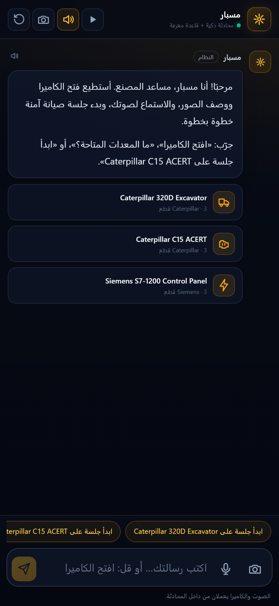
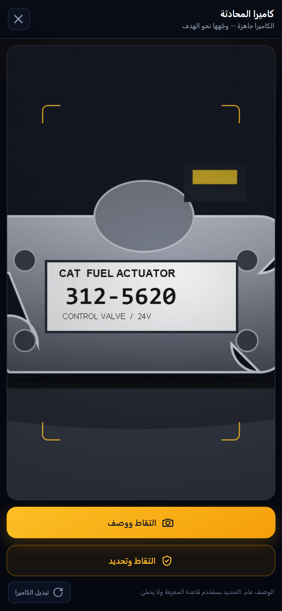
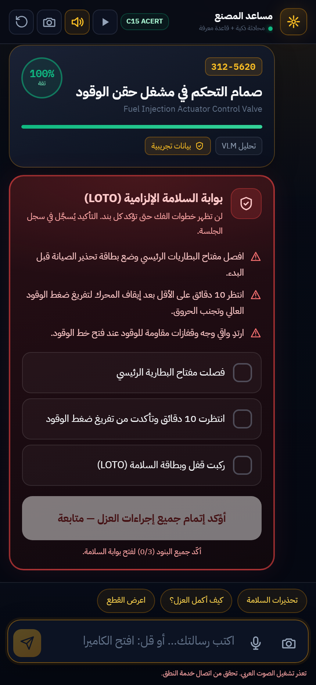
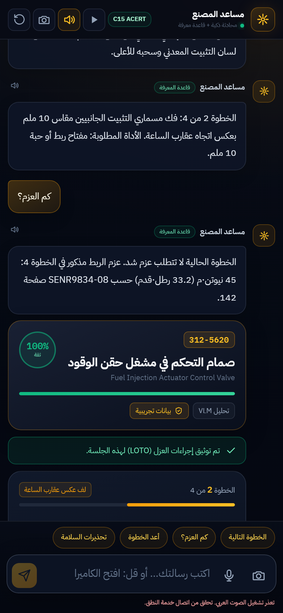
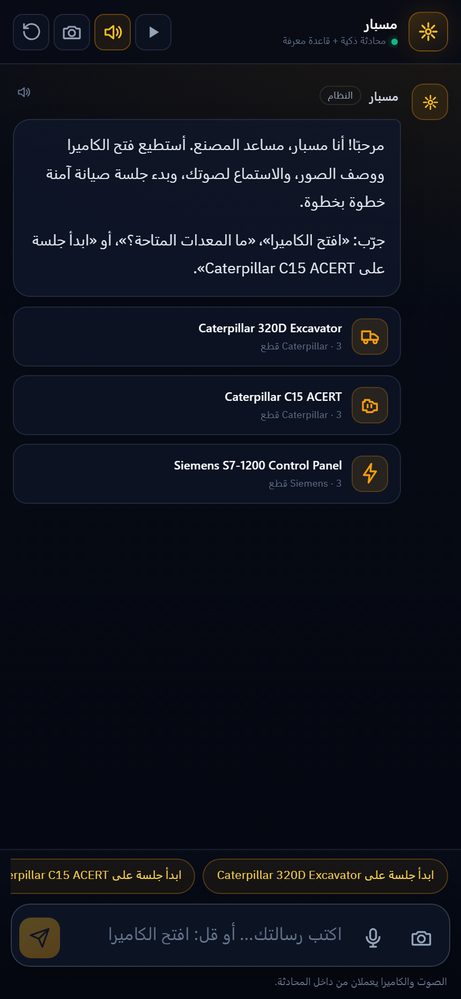
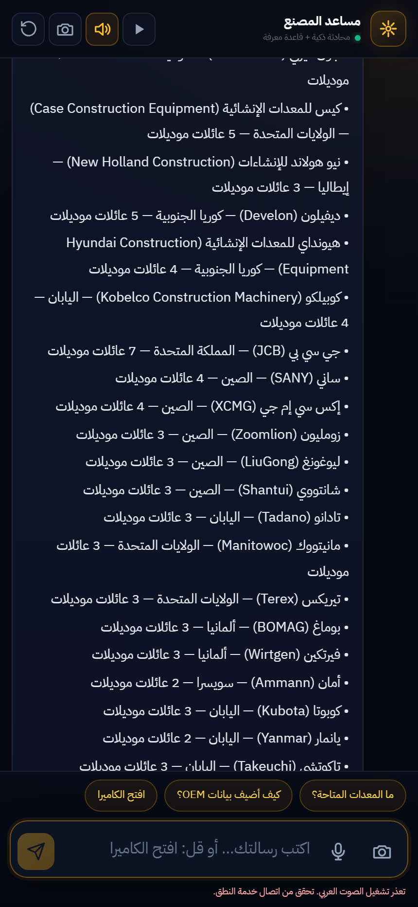

# مسبار (Masbar) — مساعد المصنع الصناعي

**المستودع:** https://github.com/Alooosh123/Masbar

مسبار مساعد محادثة عربي (RTL) بوضع داكن، يعمل بالكاميرا والصوت من داخل المحادثة، ويجمع بين محادثة عامة ذكية ومحرك صيانة صناعي حتمي مع بوابة سلامة **LOTO** ومنع صارم للهلوسة.

> **الحالة: نسخة تجريبية (MVP) قابلة للتشغيل الكامل.**
> كل بيانات المعرفة الحالية **تجريبية** (`data_status: sample`) وموسومة بوضوح داخل الواجهة. لا تستخدمها لأي عمل صيانة حقيقي قبل استبدالها بأدلة المصنّع الرسمية.

---

## 1. ما يعمل الآن

| المكوّن | الحالة |
| --- | --- |
| Backend (FastAPI + Pydantic) | ✅ يعمل — **91 اختبار pytest ناجحًا على فرع التطوير (CI)** |
| واجهة المحادثة (Chat-first) | ✅ فقاعات، ردود سريعة، بطاقات قطعة/سلامة/خطوة، صور، وضع داكن RTL |
| نقطة المحادثة الموحّدة `/api/v1/chat` | ✅ أوامر + جلسة + تحديد + وصف صور + محادثة عامة |
| محرك السلامة الحتمي (LOTO + العزم) | ✅ يُفرض على الخادم ولا يمكن تجاوزه من الواجهة أو المحادثة |
| البحث الهجين في قاعدة المعرفة | ✅ يعمل محليًا بدون أي خدمة خارجية |
| سجل مصادر OEM الرسمية | ✅ **31 شركة و126 عائلة موديلات** مع روابط رسمية وبحث |
| تحديد القطعة بالنص / الرقم / الصورة | ✅ Mock افتراضي + OpenRouter Nemotron 3.5 Super VL المجاني / Cohere / OpenAI VLM |
| وصف الصور العامة | ✅ Cohere Command A Vision — مستقل عن تاريخ الكاميرا |
| الكاميرا داخل المحادثة | ✅ فتح/إغلاق بالأمر، التقاط ووصف، والتقاط وتحديد صريح |
| الصوت العربي (ASR/TTS) | ✅ TTS عصبي عربي من الخادم (`ar-SA-ZariyahNeural`) + ذاكرة صوتية محلية + ASR عربي في المتصفح |
| الجلسات وسجل التدقيق | ✅ SQLite محلي دائم مع TTL واستعادة بعد إعادة تشغيل الخادم؛ Docker volume |
| اختبار E2E آلي | ✅ **34/34 فحصًا مسجلاً** عبر Chrome/CDP؛ كاميرا canvas وميكروفون وهميان وليسا أجهزة ميدانية |
| كتيبات OEM (PDF) | ✅ استيعاب محلي + بحث BM25 مع مراجع صفحات؛ مقتطفات البحث معطلة افتراضياً في الإنتاج |
| Docker | ✅ صورتا Backend وFrontend بُنيتا؛ اختبار التشغيل يثبت عمل الواجهتين ووساطة API من نفس النطاق واستعادة الجلسة بعد إعادة التشغيل |

### لقطات من واجهة المحادثة (عرض جوال 430px)

| المحادثة | الكاميرا | بوابة LOTO | العزم |
| --- | --- | --- | --- |
|  |  |  |  |

| اختبار الصوت العربي | سجل شركات OEM |
| --- | --- |
|  |  |

تفاصيل الاختبار الفعلي والقياسات في **[docs/TEST_RESULTS.md](docs/TEST_RESULTS.md)**.

---

## 2. التشغيل السريع (Windows / PowerShell)

```powershell
# انتقل إلى مجلد المشروع بعد استنساخه من GitHub
cd path\to\Industrial_Spatial_AI_Assistant

# 1) البيئة الخلفية (مرة واحدة)
.\.venv\Scripts\python.exe -m pip install -r backend\requirements.txt

# 2) تثبيت حزم الواجهة (مرة واحدة)
cd web; npm.cmd install; cd ..

# 3) تجهيز عينة الصوت العربي للعمل دون اتصال (مرة واحدة)
.\.venv\Scripts\python.exe scripts\seed_tts_cache.py

# 4) تشغيل الخادم
.\scripts\dev-backend.cmd

# 5) في نافذة ثانية: تشغيل الواجهة
.\scripts\dev-web.cmd
```

> إذا كانت سياسة التنفيذ تمنع `.ps1`، استخدم أغلفة `.cmd` أعلاه — فهي تتجاوز السياسة محليًا دون تغيير إعدادات النظام. يمكنك أيضًا تشغيل `powershell -ExecutionPolicy Bypass -File .\scripts\dev-backend.ps1`.

ثم افتح: **http://localhost:5173**

- في التطوير المحلي تستخدم الواجهة `http://<اسم-الجهاز-الحالي>:8010`؛ في الإنتاج تستخدم نطاقها نفسه وتمرر Nginx طلبات API إلى Backend داخلياً.
- **لماذا 8010؟** المنفذ 8000 محجوز على هذا الجهاز من خدمة Mizan Router (Docker). المشروع يستخدم 8010 افتراضيًا؛ يمكنك تغييره من `scripts/dev-backend.ps1` و`web/src/lib/api.ts` أو بضبط `VITE_API_URL`.
- للوصول من هاتف على نفس الشبكة: افتح `http://<IP-الجهاز>:5173` (الخادم يستمع على `0.0.0.0`).
- الكاميرا وWeb Speech يحتاجان **HTTPS أو localhost**. للاختبار من هاتف على الشبكة المحلية استخدم نفق HTTPS (مثل `cloudflared tunnel --url http://localhost:5173`) أو شغّل الواجهة عبر HTTPS.

### التحقق من الحالة

```powershell
Invoke-RestMethod http://localhost:8010/health
```

المتوقع: `status=online`، `components=9`، `equipment=3`، `vision_provider` حسب مزودك (مثلاً `openrouter`)، و`chat_provider` حسب إعداد المحادثة، و`tts_provider=edge` مع `tts_ready=true`، و`manufacturers=31`، و`manual_documents=0` و`manual_chunks=0` قبل إضافة فهارس محلية.

### اختبار سريع لواجهة الـ API

```powershell
.\.venv\Scripts\python.exe scripts\smoke_api.py
```

أو عبر الغلاف:

```powershell
.\scripts\smoke_api.cmd
```

يشغّل دورة كاملة: جلسة → تحديد → LOTO → خطوة → سؤال → تدقيق.

---

## 3. تشغيل الاختبارات

```powershell
.\scripts\test.cmd
# أو
cd backend; ..\.venv\Scripts\python.exe -m pytest -q
```

آخر CI ناجح على `main` (commit `d0d729ab77335fa20e37a77092c4227f897a94b7`): **91 passed** في Backend، وبناء TypeScript/Vite ناجح، و`npm ci` أظهر **0 vulnerabilities**. بُنيت صور Docker وشُغّلت الخدمتان في CI، واختُبرت وساطة API من نفس نطاق الواجهة واستعادة الجلسة بعد إعادة تشغيل Backend. [عرض CI](https://github.com/Alooosh123/Masbar/actions/runs/45672867388).

### اختبار E2E فعلي للواجهة

بعد تشغيل الخادم والواجهة:

```powershell
.\.venv\Scripts\python.exe scripts\e2e_chat.py
```

يشغّل Chrome بكاميرا وميكروفون وهميين، يحقن صورة اختبارية كبث كاميرا، ثم ينفّذ السيناريو كاملًا: ترحيب → اختبار الصوت العربي → عرض شركات OEM → فتح كاميرا → وصف صورة → بدء جلسة C15 → عرض القطع → تحديد بصري → LOTO → الخطوة التالية → العزم → اختبار الميكروفون وTTS. يحفظ اللقطات في `docs/screenshots/` والنتائج في `docs/test-results/chat-e2e.json`.

النتيجة المسجلة: **34/34 فحصًا ناجحًا** في سيناريو آلي سابق. الكاميرا والميكروفون في هذا السيناريو وهميان؛ هذا ليس اختباراً ميدانياً. التفاصيل والقيود في [docs/TEST_RESULTS.md](docs/TEST_RESULTS.md).

---

## 4. إضافة مفاتيح الذكاء الاصطناعي

المشروع يعمل بدون أي مفتاح عبر `VISION_PROVIDER=mock` و`CHAT_PROVIDER=off`، لكن الوصف الذكي والمحادثة العامة يحتاجان مزوّدًا. يمكن تفعيل الرؤية عبر OpenRouter أو Cohere أو OpenAI. الإعداد المقترح للرؤية هو OpenRouter + Nemotron 3.5 Super VL:

### الخيار A — OpenRouter + NVIDIA Nemotron 3.5 Super VL المجاني (رؤية الصور عبر API فقط)

```env
VISION_PROVIDER=openrouter
OPENROUTER_API_KEY=...
OPENROUTER_BASE_URL=https://openrouter.ai/api/v1
VISION_MODEL=nvidia/nemotron-3.5-super-vl:free
VISION_TIMEOUT_SECONDS=60
DEMO_MODE=false
```

هذا الخيار يرسل الصور إلى OpenRouter من الخادم باستخدام API متوافق مع OpenAI. لا يتطلب تثبيت Ollama أو تنزيل النموذج. لا يلزم مفتاح Cohere لمساري تحديد المعدة والقطعة.

### الخيار B — Cohere للمحادثة العامة (اختياري)

```env
CHAT_PROVIDER=cohere
CHAT_MODEL=command-a-plus-05-2026
CHAT_TIMEOUT_SECONDS=45
COHERE_API_KEY=...
COHERE_BASE_URL=https://api.cohere.com/v2
```

إذا لم تكن خدمة المحادثة العامة مطلوبة، استخدم `CHAT_PROVIDER=off`. يمكن أيضًا استمرار استخدام `VISION_PROVIDER=cohere` أو `VISION_PROVIDER=openai` بدل OpenRouter.

1. عدّل `.env` في جذر المشروع ثم أعد تشغيل الخادم.
2. تحقق: `GET /health` يجب أن يعيد `vision_provider: "openrouter"` عند تفعيل Nemotron 3.5 Super VL. اختبر طلب صورة حقيقيًا؛ النموذج المجاني يخضع لحصص وتوفر مزودين وقد يرجع 429 عند بلوغ الحد. وجود اسم المتغير لا يثبت الاتصال.
3. إذا تُرك `VISION_MODEL` أو `CHAT_MODEL` فارغًا، يستخدم الخادم النموذج الافتراضي للمزوّد.
4. لتعطيل المحادثة العامة مع إبقاء أوامر الجلسة والكاميرا تعمل: `CHAT_PROVIDER=off`.

ملاحظات مهمة:

- **لا يُستخدم LLM لتوليد خطوات الصيانة أو قيم العزم أو قوائم LOTO.** كلها تُقرأ حرفيًا من `data/kb/` ويتم التحقق من صحتها عند الإقلاع. الـ VLM يُستخدم فقط لاقتراح **هوية القطعة** ووصف الصور العامة.
- Cohere يستخدم مخطط JSON صارمًا (structured outputs) ويعيد رقم قطعة من قائمة المرشحين فقط؛ أي رقم خارج القائمة يُرفض في الخادم.
- **الصور تُوصف افتراضيًا ولا تُستخدم للتحديد** إلا عند اختيار «التقاط وتحديد» أو كتابة طلب صريح مثل «حدد القطعة». وصف الصورة يُرسل مستقلًا عن تاريخ المحادثة كي لا يتأثر بأوامر الكاميرا السابقة.
- يتم تعطيل `thinking` في طلبات Cohere لتوفير ميزانية الرد وتقليل التقلب؛ النص يُستخرج من بلوكات `text` فقط.
- إذا فشل الاتصال بمزوّد الرؤية أو المحادثة، يعيد الخادم خطأً واضحًا بدل التخمين.
- الأسرار تبقى في `.env` (مستثنى في `.gitignore`) ولا تُرسل إلى الواجهة أبدًا.
- `DEMO_MODE=true` يسمح بالتحديد التجريبي عند غياب صورة أو نص. عطّله (`DEMO_MODE=false`) في الإنتاج كي لا يُستخدم أي مسار تجريبي.
- عند تفعيل مزوّد سحابي، تُرسل الصورة الملتقطة إلى ذلك المزوّد لتحديد القطعة. راجع سياسة الخصوصية والاحتفاظ بالبيانات قبل الاستخدام الميداني، أو استخدم مزوّدًا داخليًا عند الحاجة.

---

## 5. المعمارية

```
┌──────────────────────────── واجهة المحادثة (PWA) ────────────────────────┐
│ React + TS + Vite · RTL · فقاعات · كاميرا داخل المحادثة · Web Speech   │
└───────────────────────────────────┬─────────────────────────────────────┘
                                    │ REST + WebSocket
┌───────────────────────────────────▼─────────────────────────────────────┐
│                        FastAPI (Python)                                 │
│  ┌──────────────┐  ┌───────────────┐  ┌──────────────────────────────┐  │
│  │ ChatService  │  │ Safety Guard  │  │ Knowledge Base (JSON)        │  │
│  │ أوامر+محادثة │──│ Deterministic │──│ 9 قطع / 3 معدات (sample)     │  │
│  └──────┬───────┘  └───────────────┘  └──────────────────────────────┘  │
│         │ Hybrid Retrieval (exact + token + lexicon + fuzzy)            │
│  ┌──────▼───────┐  ┌───────────────┐  ┌──────────────────────────────┐  │
│  │ Sessions +   │  │ Arabic        │  │ Chat/Vision Adapters         │  │
│  │ Audit Log    │  │ Normalizer    │  │ off/mock | Cohere/OpenAI     │  │
│  └──────────────┘  └───────────────┘  └──────────────────────────────┘  │
└─────────────────────────────────────────────────────────────────────────┘
```

### مسار المحادثة الموحّد

`POST /api/v1/chat` هو نقطة الدخول الأساسية للواجهة. يستقبل `{message, image_base64?, mode?, session_id?, history?}` ويعيد:

| الحقل | المعنى |
| --- | --- |
| `message_ar` | رد المساعد بالعربية |
| `source` | `command` (أمر واجهة) أو `vision` (وصف) أو `kb` (قاعدة المعرفة) أو `chat` (محادثة عامة) |
| `session` | لقطة الجلسة المحدّثة إن وُجدت |
| `actions` | إجراءات واجهة مثل فتح الكاميرا أو تشغيل الميكروفون |
| `equipment` / `components` | نتائج الكتالوج عند الطلب |
| `quick_replies` | ردود سريعة جاهزة |

المسار يدعم:
- **أوامر عربية** لفتح/إغلاق الكاميرا، بدء جلسة، عرض القطع، تحديد، تأكيد LOTO، التنقل بين الخطوات، والعزم.
- **وصف الصور** عبر VLM بشكل مستقل تمامًا عن تاريخ المحادثة (لا يُستخدم للتحديد إلا بوضع `identify` صريح).
- **محادثة عامة** عبر `CHAT_PROVIDER` مع تعليمات تمنع اختراع أرقام القطع أو قيم العزم أو إجراءات العزل.
- **تحديد بصري** عبر `POST /{session_id}/identify` بنفس محرك الرؤية والتحقق الحتمي.

### مسار الجلسة (HTTP)

1. `POST /api/v1/sessions` — إنشاء جلسة لمعدة محددة.
2. `POST /{id}/identify` — تحديد القطعة (نص/رقم/صورة). عند نجاح التحديد تُعاد قائمة LOTO وتُقفل خطوات الصيانة.
3. `POST /{id}/loto` — تأكيد بنود العزل. **يجب تأكيد كل البنود الإلزامية**؛ التأكيد الجزئي يبقي الجلسة مقفلة.
4. `POST /{id}/step` — التنقل بين الخطوات (`next/prev/repeat/goto`).
5. `POST /{id}/ask` — أسئلة حرة (عزم، أدوات، تحذيرات) تُجاب من قاعدة المعرفة فقط.
6. `GET /{id}/audit` — سجل تدقيق كامل.

الـ WebSocket: `ws://localhost:8010/ws/sessions/{id}` يبث لقطة الحالة عند كل تغيير.

### هيكل المشروع

```
backend/
  app/
    api/routes/      # health, catalog, sessions, chat, ws
    core/            # config, arabic normalizer
    domain/          # enums + Pydantic models (chat request/response)
    knowledge/       # loader, validation, lexicon, retrieval
    safety/          # deterministic guard (LOTO, torque, hallucination)
    services/        # chat orchestration, sessions, audit
    adapters/
      chat/          # cohere chat + vision descriptions
      tts/           # Arabic neural TTS (Edge) + disk cache
      vision/        # mock + OpenAI-compatible + Cohere VLM
  tests/             # 91 tests في آخر تشغيل CI
data/kb/             # 3 ملفات معرفة تجريبية (9 قطع)
data/catalog/        # سجل مصادر OEM الرسمية (31 شركة / 126 موديلًا)
data/cache/tts/      # ذاكرة MP3 عربية للعمل دون اتصال
data/sessions/        # قاعدة SQLite محلية للجلسات (مستثناة من Git)
web/                 # PWA (React + Vite) — ChatScreen + ChatCamera
docs/blueprint/      # خطة النظام الأصلية (6 مراحل)
docs/test-results/   # تقارير الاختبار الفعلي (JSON)
docs/screenshots/    # لقطات الواجهة والاختبار
docs/test-assets/    # صور اختبار الكاميرا
prompts/             # برومبتات الوكلاء (مرجعي)
scripts/             # تشغيل + اختبار + smoke + e2e_chat.py
```

---

## 6. ضمانات السلامة (مهم)

- **بوابة LOTO على الخادم:** لا تُفتح الخطوات إلا بعد تأكيد كل بنود العزل الإلزامية. لا توجد أي طريقة لتجاوزها من الواجهة أو من أوامر المحادثة.
- **العزم من المصدر فقط:** كل قيمة عزم تحمل `source_document_id` و`source_page` و`verified_from_manual`. لا يُسمح لأي نص مولّد أن يخترع رقمًا، بما في ذلك ردود المحادثة العامة.
- **رفض الثقة المنخفضة:** تحديد بصري بثقة أقل من `MIN_VISUAL_CONFIDENCE` (0.85 افتراضيًا) لا يفتح الخطوات؛ يُطلب من الفني الاقتراب أو استخدام رقم القطعة.
- **فصل الوصف عن التحديد:** صورة الكاميرا الافتراضية تُوصف وصفًا عامًا ولا تغيّر القطعة أو الجلسة. التحديد لا يحدث إلا بطلب صريح أو وضع `identify`.
- **سؤال خارج النطاق:** إذا لم يجد البحث مصدرًا، يجيب المساعد بأن المعلومة غير متوفرة في قاعدة المعرفة بدل التخمين.
- **سجل تدقيق:** كل تحديد، تأكيد LOTO، تنقل بين الخطوات، وسؤال يُسجّل مع طابع زمني.
- **إعادة تعيين آمنة:** أي تحديد جديد لقطعة مختلفة يعيد تعيين تأكيدات السلامة (عبر `identification_id`).

---

## 7. البيانات التجريبية

| الملف | المعدة | القطع |
| --- | --- | --- |
| `data/kb/cat_c15_fuel_system.json` | Caterpillar C15 | 3 |
| `data/kb/siemens_s7_panel.json` | Siemens S7 Panel | 3 |

كل ملف يمر عبر `loader.py` الذي يتحقق من: الحقول الإلزامية، تطابق أرقام القطع، وجود مصدر لكل عزم، ووجود بنود LOTO. أي ملف غير صالح يمنع إقلاع الخادم برسالة واضحة.

**لاستبدالها ببيانات حقيقية:** استخدم مستورد OEM المعتمد بدل النسخ اليدوي:

```powershell
.\.venv\Scripts\python.exe scripts\import_oem_data.py --input .\oem_exports\cat_320.json
.\.venv\Scripts\python.exe scripts\import_oem_data.py --input .\oem_exports\cat_320.json --apply
```

المستورد يرفض أي سجل بلا `source_document_id` و`source_page` و`verified_from_manual=true`، ويرفض أي خطوة تطلب عزمًا دون قيمة موثقة. راجع [docs/OEM_DATA.md](docs/OEM_DATA.md).

### سجل شركات المعدات الثقيلة

`data/catalog/oem_registry.json` يربط **31 شركة** و**126 عائلة موديلات** بمصادرها الرسمية:

- الاسم العربي والإنجليزي، بلد المنشأ، الموقع الرسمي، وبوابات الخدمة/القطع إن وُجدت.
- مستوى الوصول: `public_catalog` أو `dealer_portal` أو `subscription` أو `manual_required`.
- بحث بالاسم أو الموديل عبر `/api/v1/manufacturers?q=PC200`.
- من المحادثة: **«ما الشركات المتاحة؟»** و**«هل البيانات حقيقية؟»**.

وجود الشركة والرابط والموديل **لا يعني** توفر كتيب الصيانة. قيم العزم وخطوات الفك وLOTO تبقى `sample` حتى استيراد كتيب OEM معتمد؛ المساعد لا يخترع أي قيمة.

### استيعاب كتيبات OEM والبحث داخلها (أول نسخة)

أضيف مسار محلي لاستيعاب ملفات PDF المصرح بمعالجتها، واستخراج النص وتقسيمه إلى مقاطع مرتبطة بمرجع الوثيقة والصفحة:

- أداة الاستيعاب: `scripts/ingest_manual.py`.
- فهرس التشغيل المحلي: `data/manual_index/` (مستثنى من Git).
- قائمة المستندات: `GET /api/v1/manuals`.
- البحث: `GET /api/v1/manuals/search?q=shaft%20seal`.
- من المحادثة: **«ابحث في الكتيبات عن shaft seal»**.

كل نتيجة تحفظ `pdf_page_index` و`pdf_page_number` و`printed_page_number` منفصلة عند توفرها. يتطلب الاستيعاب تأكيد حق معالجة الملف وتوضيح أساس الإذن؛ لا ترفع ملفات OEM أو مفهرساتها المحمية إلى GitHub.

**التحكم في الوصول:** بحث المقتطفات معطل افتراضياً عبر `MANUAL_SEARCH_ENABLED=false`. يمكن تفعيله فقط في تشغيل محلي/خاص بإضافة `MANUAL_SEARCH_ENABLED=true` إلى ملف `.env`. لا تفعّله على خادم مكشوف للإنترنت؛ التطبيق لا يملك حالياً مصادقة وصلاحيات لحماية نصوص الكتيبات. إعداد Docker Compose يبقيه معطلاً دائماً.

**حدود النسخة الحالية:** البحث نصي BM25/lexical فقط؛ لا يوجد Qdrant أو embeddings أو OCR أو استخراج آلي لجداول العزم أو تحليل رسومات تفجيرية حتى الآن. الصفحات التي لا يُستخرج منها نص كافٍ تُعلّم للمراجعة لتحديد الحاجة إلى OCR؛ وقد تكون صفحات فارغة أو رسومات وليست بالضرورة صفحات ممسوحة. نتائج البحث مقتطفات موثقة وليست تعليمات صيانة معتمدة، ولا تتحول إلى قيم عزم أو إجراءات LOTO تشغيلية تلقائياً.

الدليل التفصيلي: [docs/MANUAL_INGESTION_GUIDE_AR.md](docs/MANUAL_INGESTION_GUIDE_AR.md). وسجل مصدر Grundfos CR 5 Model A: [docs/equipment/GRUNDFOS_CR5_MODEL_A_SOURCE_REGISTER_AR.md](docs/equipment/GRUNDFOS_CR5_MODEL_A_SOURCE_REGISTER_AR.md).

---

## 8. تخزين الجلسات

يحفظ مِسبار الجلسات وسجل التدقيق في SQLite محلياً داخل `data/sessions/sessions.sqlite3` افتراضياً (`SESSION_DB_PATH`). في Docker يستخدم volume دائم باسم `misbar_sessions`، حتى تبقى البيانات بعد استبدال الحاوية. مدة الصلاحية الافتراضية 240 دقيقة (`SESSION_TTL_MINUTES`).

هذا التخزين مخصص لنسخة تطبيق واحدة على مضيف واحد؛ لا يوفر مشاركة آمنة بين عدة workers أو hosts، ولا نسخاً احتياطياً آلياً أو استعادة مجربة. عند التوسع يلزم تخزين مشترك وإعداد نسخ احتياطية واختبار الاستعادة.

## 9. Docker

```powershell
docker compose up --build
```

- الواجهة: http://localhost:8080
- الخادم: http://localhost:8010
- لتفعيل OpenAI: أنشئ `.env` بجانب `docker-compose.yml` بنفس متغيرات القسم 4 (يُقرأ عبر `env_file`).

تم بناء الصورتين وتشغيلهما في GitHub Actions. يتحقق الاختبار من عمل الواجهة ووساطة `/health` و`/api/v1/*` من نفس النطاق، ومن عمل Backend بهوية UID 10001 وجذر ملفات للقراءة فقط، ثم يستعيد جلسة وسجل تدقيق بعد إعادة تشغيل الخادم. هذا اختبار CI وليس نشراً مستمراً على خادم. إذا كان المنفذ 8010 مستخدماً من التشغيل المحلي، أوقف الخادم المحلي أولاً.

---

## 10. استكشاف الأخطاء

| المشكلة | الحل |
| --- | --- |
| `npm` لا يعمل في PowerShell | استخدم `npm.cmd` (سياسة التنفيذ تمنع `npm.ps1`). |
| سكربت `.ps1` لا يعمل | استخدم غلاف `.cmd` المقابل، أو `powershell -ExecutionPolicy Bypass -File ...`. |
| الواجهة لا تتصل بالخادم | تأكد أن الخادم يعمل على 8010، أو اضبط `VITE_API_URL` في `.env`. |
| الكاميرا لا تعمل | تحتاج `localhost` أو HTTPS، واذن الكاميرا في المتصفح. |
| الصوت لا يعمل | التطبيق يستخدم TTS عصبيًا عربيًا من الخادم. إذا أعاد `/api/v1/tts` الرمز 503 فخدمة Edge غير متاحة من الشبكة؛ الصوت المخزّن في `data/cache/tts/` يعمل دون اتصال. لا يوجد fallback إلى صوت إنجليزي. |
| المحادثة ترد بخطأ مزوّد | تحقق من `CHAT_PROVIDER` و`COHERE_API_KEY`، ثم راقب `logs/backend.err.log`. يمكنك تعطيل المحادثة العامة بـ `CHAT_PROVIDER=off`. |
| الوصف العام لا يذكر القطعة | تأكد من وضوح الإضاءة والنص. الوصف عبر مزوّد خارجي؛ إذا لم يظهر النص فاستخدم «التقاط وتحديد» أو الكتابة اليدوية. |
| التحديد البصري يرفض الصورة | راجع `MIN_VISUAL_CONFIDENCE` أو قرّب الكاميرا من الملصق. |
| الخادم يفشل عند الإقلاع | اقرأ رسالة التحقق من قاعدة المعرفة — غالبًا ملف JSON ناقص حقلًا. |
| تحذير httpx في الاختبارات | تحذير من Starlette فقط، لا يؤثر على النتائج. |

---

## 11. خارطة الطريق

- [x] المرحلة 1: معمارية + Backend + قاعدة معرفة + محرك سلامة.
- [x] المرحلة 2: استرجاع هجين + تطبيع عربي + جلسات + تدقيق.
- [x] المرحلة 3: واجهة PWA ميدانية + كاميرا + AR overlay + صوت.
- [x] المرحلة 3.5: تحويل الواجهة إلى مساعد محادثة عربي + كاميرا/صوت داخل المحادثة + `/api/v1/chat` + وصف صور حي.
- [x] المرحلة 3.6: صوت عربي عصبي من الخادم + ذاكرة MP3 محلية + سجل 31 شركة OEM مع بحث واستيراد موثّق.
- [ ] المرحلة 4: ASR خادمي (faster-whisper) للمصانع عالية الضوضاء.
- [ ] المرحلة 5: فهرسة متجهات (Qdrant) + رسم بياني للمعدات (Neo4j).
- [ ] المرحلة 6: تطبيق Expo/Native + AR Core/ARKit + SLAM.
- [ ] المرحلة 7: استيراد كتيبات خدمة OEM مرخّصة وتعبئة قيم العزم/LOTO لكل موديل.
- [ ] المرحلة 8: اختبار الكاميرا والميكروفون على أجهزة ميدانية حقيقية عبر HTTPS.

---

## 12. المراجع

- خطة النظام الأصلية: `docs/blueprint/`
- تقرير التقدم التفصيلي: `docs/PROGRESS.md`
- توثيق الـ API التفاعلي: http://localhost:8010/docs


### حسابات العملاء وتسجيل الدخول

تدعم واجهة الدخول حسابات العملاء وحسابات فريق العمل من نفس البوابة. ينشئ المالك أو المدير حساب العميل مسبقًا بالدور customer؛ لا يوجد تسجيل عام ذاتي. العميل يستطيع المحادثة وتحليل الصور وفتح جلسات الفحص، لكن تأكيد LOTO وتقدّم خطوات التنفيذ يظلان محصورين بالفنيين والمالك والمدير.

## 13. النشر السحابي ومفاتيح الذكاء الاصطناعي

يستخدم نشر Railway خدمتين: Backend خاص وFrontend عام، مع تمرير `/api` و`/health` و`/ws` عبر Nginx من نفس نطاق الواجهة.

- يمكن تشغيل الرؤية عبر OpenRouter + Nemotron 3.5 Super VL باستخدام `OPENROUTER_API_KEY` المحفوظ كسر في Backend، مع فصل إعداد المحادثة العامة.
- إعداد الرؤية المقترح: `VISION_PROVIDER=openrouter` و`VISION_MODEL=nvidia/nemotron-3.5-super-vl:free` و`DEMO_MODE=false`. لا يحتاج إلى Ollama أو تنزيل نموذج.
- المصادقة الحالية على `main` تستخدم Cookie آمنًا HttpOnly، وتُفعّل عبر `AUTH_REQUIRED=true` و`JWT_SECRET_KEY` وبيانات المالك الأول الموضحة في دليل Railway.
- يستخدم الخادم Volume دائمًا في `/app/data/sessions` لقاعدة SQLite. التخزين مناسب لنسخة Backend واحدة، وليس لتشغيل عدة نسخ متزامنة.
- بيانات الصيانة التسع ما زالت `sample`؛ لا تستخدم عزمًا أو إجراءً صناعيًا قبل استيراد كتيب OEM مرخّص ومراجعته من شخصين مستقلين.
- اختبارات الكاميرا والميكروفون الآلية تستخدم أجهزة وهمية. اختبار الأجهزة الفعلية موثق في `docs/REAL_DEVICE_TEST_CHECKLIST_AR.md`.

التفاصيل في [دليل النشر السحابي](docs/RAILWAY_DEPLOYMENT_GUIDE_AR.md) و[دليل إعداد Nemotron 3.5 Super VL عبر OpenRouter API](docs/OPENROUTER_NEMOTRON_3_5_SUPER_VL_SETUP_AR.md).
